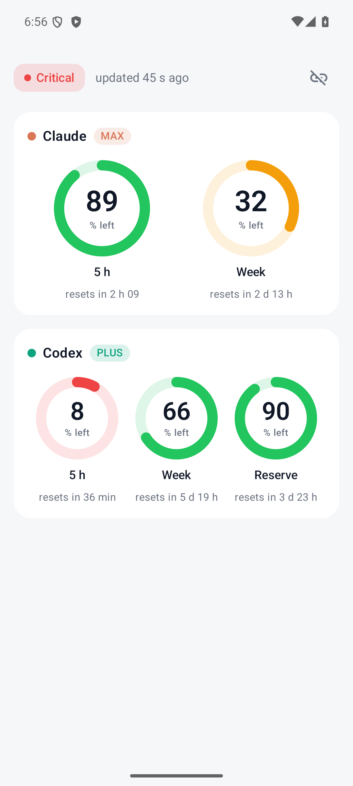
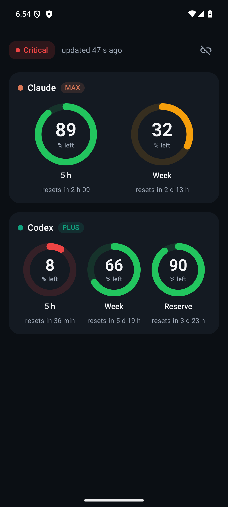
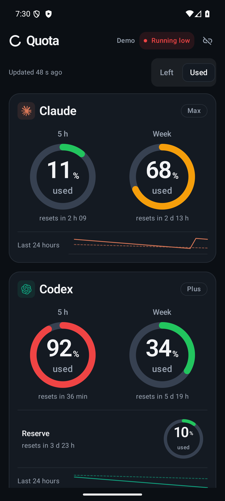
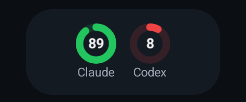
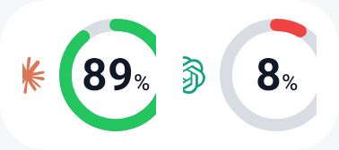
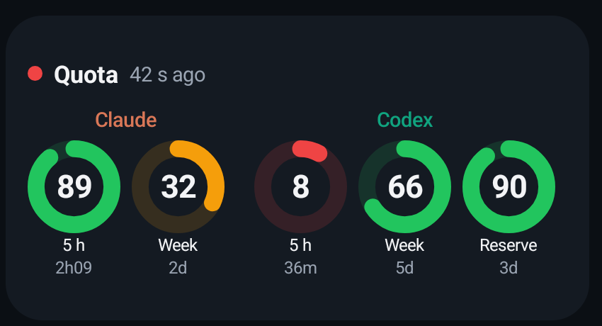
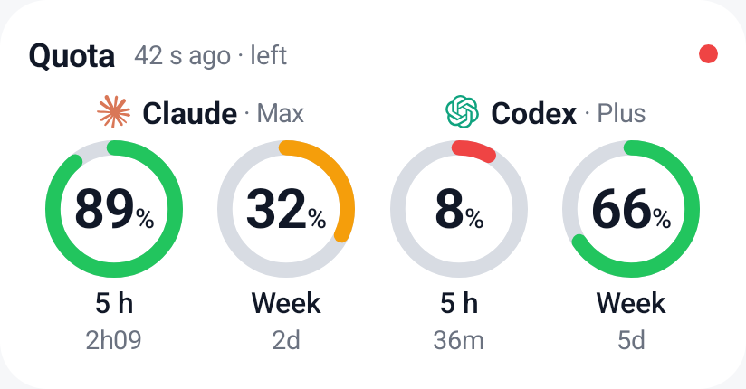
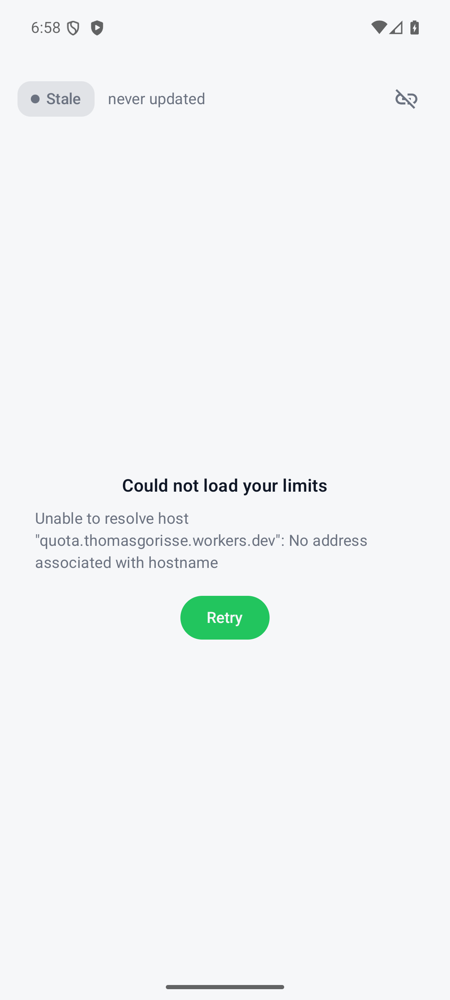

# Quota for Android

Compose app + Glance widget for the `/v1/status` contract in the [root README](../README.md).
Package `com.gorisse.thomas.quota`, minSdk 26, Material 3 with dynamic colour **off** — the
palette is the one in [`docs/DESIGN.md`](../docs/DESIGN.md) and severity has to mean the same
green, amber and red on every device.

## Build and run

```bash
./gradlew :app:assembleDebug
adb -s emulator-5554 install -r app/build/outputs/apk/debug/app-debug.apk
```

Versions are pinned in `gradle/libs.versions.toml`: Gradle 8.14.5, AGP 8.13.2, Kotlin 2.4.10,
Compose BOM 2026.06.01, compileSdk 36 — the set already known to work on this machine.

## Seeing it without a backend

The pairing screen carries a **Try with sample data** button, in every build type including
release. It fills the repository — and therefore the widget — with `DemoData`, whose numbers
cover the three severities and whose reset times are relative to now. Nothing is fetched: the
repository short-circuits before the API, so the mode is offline by construction.

It is not a hidden developer affordance, it is the answer to Play's "Sign-in details" form —
an app whose whole value needs a paired Mac is otherwise a blank screen to a reviewer. While
it is on, a persistent **Sample data** chip sits in the app header and on both widget sizes,
and the header's link-off button reads *Leave sample data*.

The widget itself can be captured without dragging anything onto a launcher:

```bash
adb shell appwidget grantbind --package com.gorisse.thomas.quota --user 0
adb shell am start -n com.gorisse.thomas.quota/.debug.WidgetPreviewActivity
```

That debug activity binds the real provider into an `AppWidgetHost` at 2×1 and 4×2, so what it
shows is the actual RemoteViews Glance produces. It is not a substitute for the launcher,
though: it hard-codes 160 × 80 dp, and a real 2 × 1 cell is 172 × 104 dp on a Pixel 7a. That
12 dp gap is the whole margin the 2 × 1 layout has, so the preview is the *tighter* of the two
— useful as a worst case, misleading as a portrait. The screenshots below are launcher crops.

## Screenshots

| | |
|---|---|
|  |  |
|  |  |
|  |  |
|  | |

The four widget shots are the widget placed on the emulator's own launcher, not the preview
harness — 2 × 1 and 4 × 2, light and dark.

The third shot is the same screen with the header's **Left / Used** control flipped: the arcs
grow with usage and the big number is the used percentage.

And the error state, captured by pairing against the host before it was deployed:


## Shape of the code

| File | Why it exists |
|---|---|
| `data/Status.kt` | The wire contract, plus `remaining = 100 - percent` and the severity rule |
| `data/Pairing.kt` | Parses `https://<host>/#t=<token>`; stores it encrypted |
| `data/StatusRepository.kt` | The single source of truth for app **and** widget, cache included |
| `ui/RingGauge.kt` | The phone ring: Compose `drawArc`, 400 ms ease-out on value change only |
| `widget/RingBitmap.kt` | The widget ring: Glance has no arc primitive, so it is a Canvas bitmap |
| `widget/RefreshWorker.kt` | WorkManager, every 15 min while a widget is placed, plus on app open |

Signing and Play upload: see [`docs/release.md`](docs/release.md).
