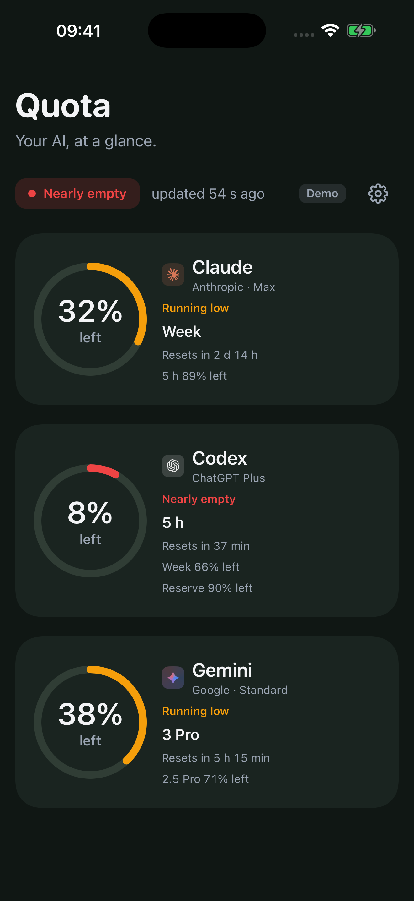
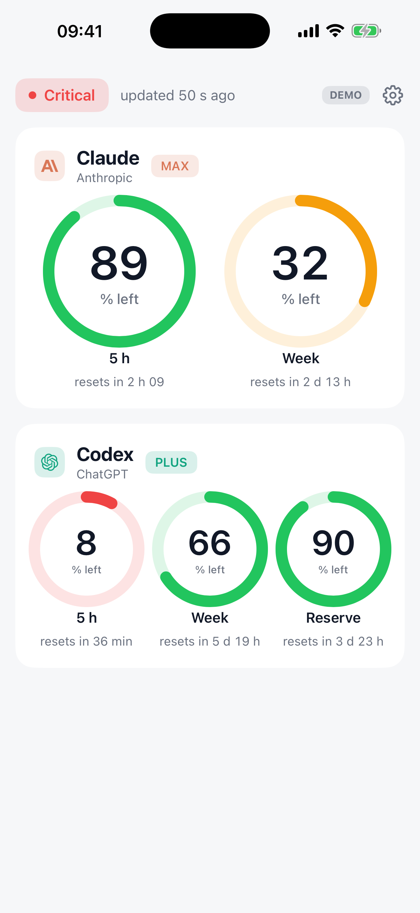
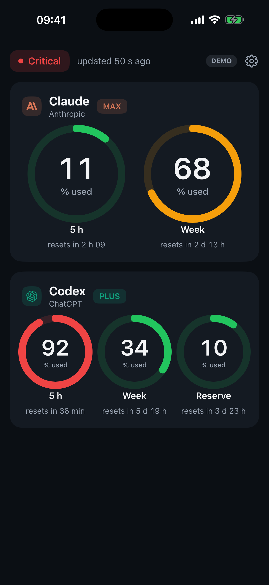
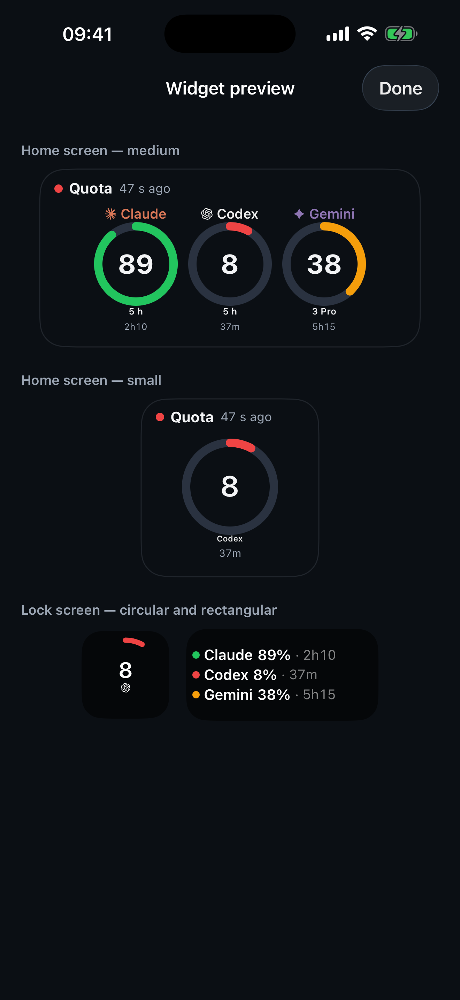
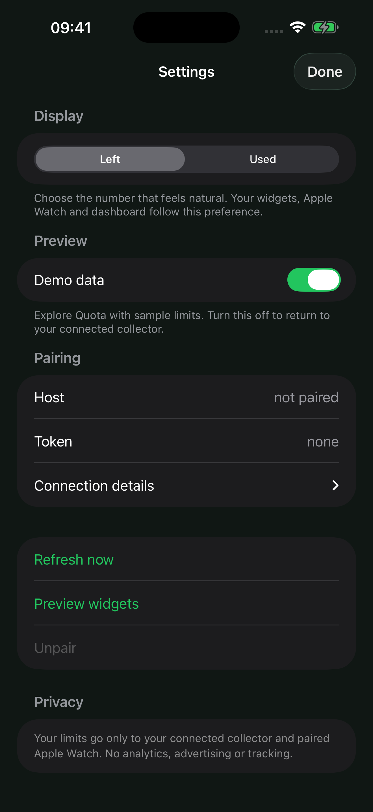
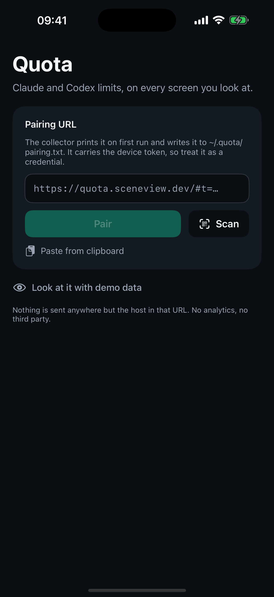
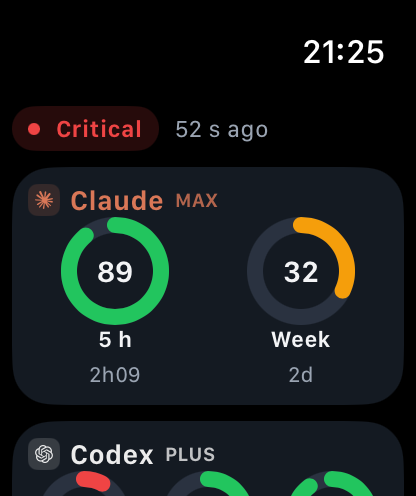

# Quota for Apple

SwiftUI app, WidgetKit extension and watchOS app for the `/v1/status` contract in the
[root README](../README.md). Bundle id `com.gorisse.thomas.quota`, iOS 17+, watchOS 10+,
Swift 5.9, **no third-party dependency** — nothing but system frameworks is linked.

The palette is the one in [`docs/DESIGN.md`](../docs/DESIGN.md), not a system accent: severity
has to mean the same green, amber and red here as it does on Android, on the web dashboard and
on the e-ink screen.

## Targets

| Target | What |
|---|---|
| `Quota` | The phone app: pairing, the two provider cards, Settings, `BGAppRefreshTask` |
| `QuotaWidgets` | Home screen small + medium, lock screen circular + rectangular |
| `QuotaWatch` | watchOS app, every window as a ring in a scrollable view |
| `QuotaWatchWidgets` | Complications: circular, corner, rectangular, inline |

`Quota.xcodeproj` is **generated** — edit [`project.yml`](project.yml) and re-run `xcodegen`,
never the pbxproj. Every target compiles `Sources/Shared` directly rather than linking a
framework: four small targets, one copy of the contract, and no embedded binary to sign.

## Build and run

```bash
brew install xcodegen          # once
xcodegen generate

xcodebuild build -scheme Quota \
  -destination 'platform=iOS Simulator,name=iPhone 17 Pro Max' CODE_SIGNING_ALLOWED=NO

# The watch simulator runtime is a separate download:
xcodebuild -downloadPlatform watchOS
xcrun simctl create quota-watch \
  com.apple.CoreSimulator.SimDeviceType.Apple-Watch-Series-11-46mm \
  com.apple.CoreSimulator.SimRuntime.watchOS-26-2
xcodebuild build -scheme QuotaWatch \
  -destination 'platform=watchOS Simulator,name=quota-watch' CODE_SIGNING_ALLOWED=NO
```

Building `Quota` builds all four: the widget extension lands in `Quota.app/PlugIns/` and the
watch app, with its own complication extension inside it, in `Quota.app/Watch/`.

## Seeing it without a backend

Settings carries a **Demo data** switch. It fills the shared store — and therefore the widgets
and the watch — with `DemoData`, whose numbers are the same ones the Android build uses and
deliberately cover the three severities: an ok Claude 5 h, a warn Claude week, a critical Codex
5 h. Reset times are relative to now, so the "resets in …" line stays worth looking at.

Dragging a widget onto the home screen is not scriptable, so **Settings → Preview widgets**
renders `QuotaMediumView`, `QuotaSmallView`, `QuotaCircularView` and `QuotaRectangularView` at
their real point sizes. Those are the same view types the extension builds its entries from, so
a screenshot of that screen is a screenshot of the widget, not of a look-alike.

Debug builds also take launch arguments, which is how the screenshots below were captured
without anyone tapping through:

```bash
xcrun simctl launch <device> com.gorisse.thomas.quota \
  -QuotaDemo -QuotaDisplay used -QuotaScreen widgets -QuotaWidgetOnly medium
```

`-QuotaDemo` turns demo data on before the first frame; `-QuotaDisplay remaining|used` picks the
display mode without a round trip; `-QuotaScreen settings|widgets` opens straight into a sheet;
`-QuotaDemoVariant pro` swaps the canned Codex for a two-window one — a provider reports one,
two or three windows and every layout has to hold for all three.
None of it is compiled into a Release build, and none of it can set a token: pairing still only
happens through the URL.

## Display mode

`GET /v1/status` carries a top-level `display`, `"remaining"` (the default, and what an older
backend implies) or `"used"`. In `used` mode the arc grows with usage, the big number is the
used percent and the caption says "% used". **Colours and countdowns do not move**: severity is
always computed on the used percent, so a window that is red stays red in both modes. The
Left / Used control in Settings `PUT /v1/settings {"display": …}`, so the phone, the widgets,
the watch, the web dashboard and the TRMNL screen all switch together.

## Where the token lives

The device token is a credential: it is never logged, never put in a URL this app builds, and
never sent anywhere but the paired host.

It is written to the keychain under the App Group access group so that the widget and the watch
read the same item. That access group only resolves once the bundle is signed with a real team
id — on an unsigned simulator build the keychain call comes back `errSecMissingEntitlement`, and
`TokenStore` falls back to the App Group `UserDefaults`. Settings prints which of the two is in
use under **Storage**, because "it is in the keychain" must not be a guess. The screenshots
below were taken from an unsigned build, so they say so.

## Screenshots

Simulator: iPhone 17 Pro Max (iOS 26.3) and Apple Watch Series 11 46 mm (watchOS 26.2), demo
data on.

| | |
|---|---|
|  |  |
|  |  |
|  |  |

The medium widget with a provider that reports only two windows — a Codex Pro plan sends Week
and Reserve, no 5 h: [`widget-medium-codex-pro-dark.png`](docs/screenshots/widget-medium-codex-pro-dark.png).

Widgets in light mode: [`widgets-light.png`](docs/screenshots/widgets-light.png).
The watch: 

## Shape of the code

| File | Why it exists |
|---|---|
| `Sources/Shared/Status.swift` | The wire contract, plus `remaining = 100 - percent`, the severity rule and `DisplayMode` |
| `Sources/Shared/Pairing.swift` | Parses `https://<host>/#t=<token>`, and refuses anything that is not https |
| `Sources/Shared/TokenStore.swift` | Keychain first, App Group `UserDefaults` when unsigned, and it says which |
| `Sources/Shared/SharedStore.swift` | The App Group: host, last snapshot, demo flag — what lets a widget draw before its first fetch |
| `Sources/Shared/QuotaClient.swift` | `GET /v1/status` and `PUT /v1/settings`. The only two requests this product makes |
| `Sources/Shared/RingGauge.swift` | The ring: a neutral track, 400 ms ease-out on value change only, and a minimum scale factor so Dynamic Type never pushes the number out of it |
| `Sources/Shared/WidgetViews.swift` | Every widget layout, shared so the in-app preview renders the real thing |
| `Sources/Shared/QuotaTimeline.swift` | The timeline provider, fetching on its own every 15 min |

## App Store

Everything the submission still needs, in order and with nothing left implicit:
[`docs/app-store.md`](docs/app-store.md). The team id is set, the icon is real, and the
listing copy and the 6.9-inch captures live in [`store/`](store). What is left is portal work
(App IDs, App Group, Keychain Sharing), the App Store Connect record, and one pass on a
physical device.
